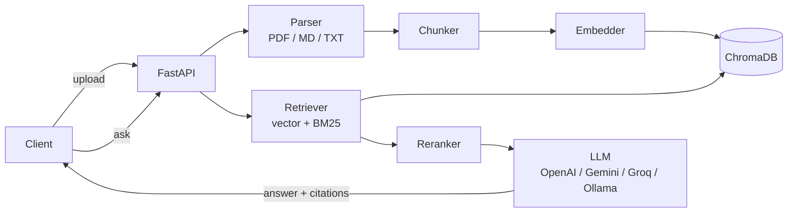

<div align="center">

# citerag

**Ask questions over your documents. Get answers with exact citations.**

[](https://github.com/Junaidjameel773/citerag/actions/workflows/ci.yml)


[](LICENSE)


</div>

---

citerag is a self-hostable REST API for retrieval-augmented generation (RAG) over PDFs, Markdown and text files. Every answer is grounded in your documents and returns the source file, page and passage it came from, so you can verify instead of trust.

## Features

| | Status |
|---|---|
| Upload PDF, Markdown and TXT files | Planned |
| Smart chunking with page-level metadata | Planned |
| Hybrid search (vector + BM25) with reranking | Planned |
| Answers with inline citations `[1]` mapped to source passages | Planned |
| Pluggable LLMs: OpenAI, Gemini, Groq, Ollama (local) | Planned |
| Streaming responses (SSE) | Planned |
| Collections to separate document sets | Planned |
| Evaluation suite (faithfulness, answer relevance) | Planned |
| Docker image and one-command deploy | Planned |

Progress is tracked in [milestones](https://github.com/Junaidjameel773/citerag/milestones).

## Architecture



## Quick start

```bash
git clone https://github.com/Junaidjameel773/citerag.git
cd citerag
cp .env.example .env        # add your API key
uv sync
uv run uvicorn citerag.main:app --reload
```

Open http://localhost:8000/docs for the interactive API.

## Configuration

| Variable | Default | Description |
|---|---|---|
| `CITERAG_LLM_PROVIDER` | `openai` | `openai`, `gemini`, `groq` or `ollama` |
| `CITERAG_CHROMA_PATH` | `./data/chroma` | Where the vector store is persisted |
| `OPENAI_API_KEY` | | Required for the OpenAI provider |
| `GEMINI_API_KEY` | | Required for the Gemini provider |

## API

| Method | Endpoint | Description |
|---|---|---|
| `GET` | `/health` | Service status and version |

More endpoints land as milestones complete.

## Development

```bash
uv sync
uv run pytest            # tests
uv run ruff check .      # lint
uv run ruff format .     # format
```

## Roadmap

- **v0.1 Core ingestion:** parsing, chunking, embeddings, vector store
- **v0.2 Retrieval & answers:** search, citations, LLM providers, streaming
- **v0.3 Quality:** hybrid search, reranking, evaluation suite
- **v0.4 Ship it:** Docker, auth, rate limiting, docs

## License

[MIT](LICENSE)
